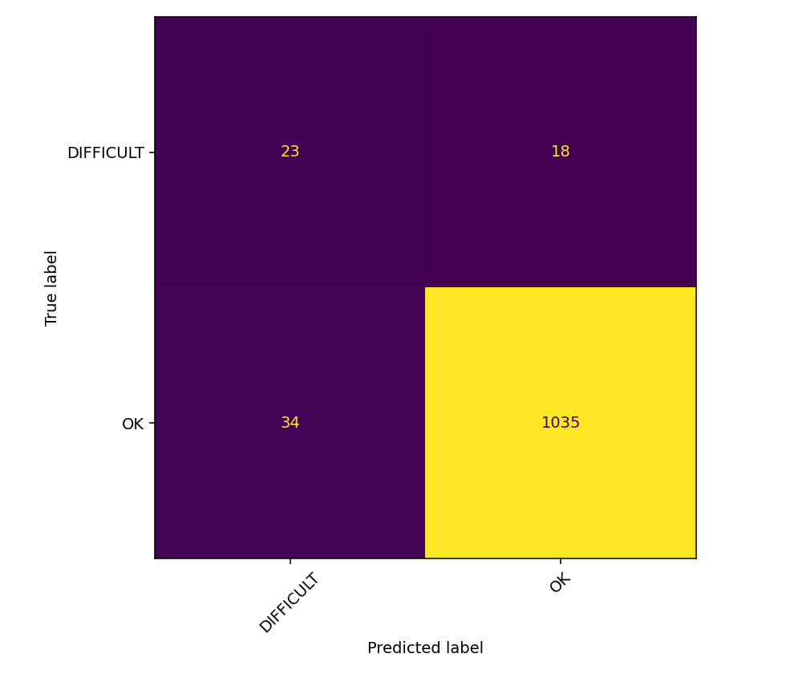
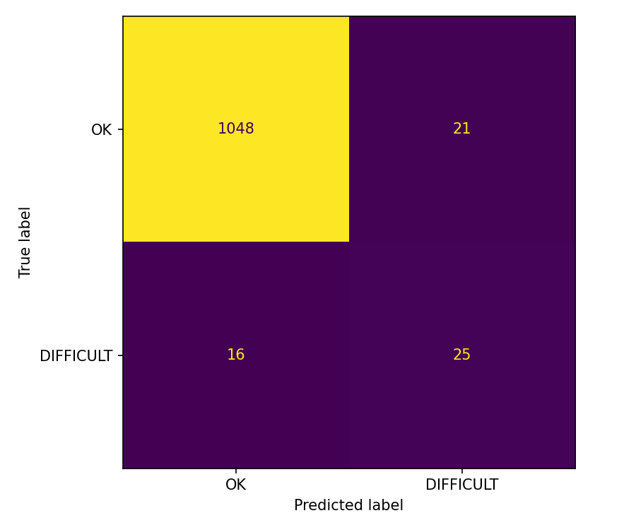
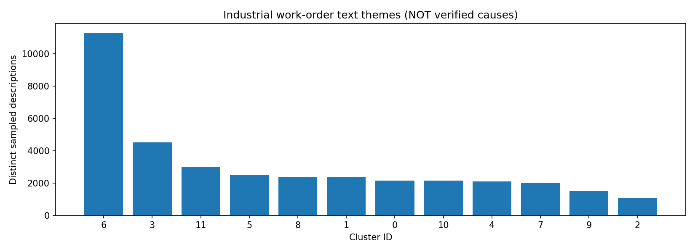
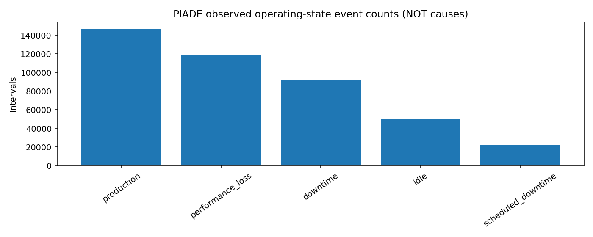

# DowntimeReason Miner — Maintenance Intelligence Research

**Day 26 / 100 · FastAPI + React + NLP · Research prototype · Not safety validated**
**Language / Bahasa:** [English](README.md) · [Bahasa Indonesia](docs/id/README.md)

## Overview

DowntimeReason Miner is Day 26 of the 100 Days of Projects series: a research-oriented text analysis and historical operations intelligence prototype. It combines an aviation maintenance-logbook classifier, unsupervised clustering of synthetic industrial work orders, and historical PIADE production-state reporting. These are **three separate evidence streams**, not one fused or causal predictor.

## Before — Now — Next

**Before:** raw archives, inconsistent work-order dates, sparse cause annotations, no browser inference. **Now:** reproducible Kaggle notebook, Experiment 01 and 02 models, twelve exploratory text clusters, a local FastAPI service, a React application, and versioned research reports. **Next:** verify Operational Analytics end to end, add labeled external validation, audit model drift and cluster meaning, implement CI/security hardening, and prepare an intentionally limited research deployment.

## Research questions

The application asks (1) whether a logbook entry resembles an observed `PROBLEM_TYPE` annotation, (2) which **wording theme** best matches an industrial work-order description, and (3) how historical production downtime, idle states, and alarm frequencies were distributed. It **does not** answer which part failed, why it failed, whether an aircraft is safe, or when a production line will fail.

## Data provenance and separation

The sources are **Industrial Maintenance Synthetic** (`Jvachier/industrial-maintenance-synthetic`, synthetic work-order text), **Annotated Maintenance Logbook** (Zenodo record `20779601`, aviation annotations), and **PIADE** (University of Padua repository record `1459`, production events and hourly features). Raw datasets are not redistributed in this repository; verify each upstream license and permitted downstream use independently. Never join these sources by row number or imply that one source supplies labels for another.

## Data audit

The Kaggle audit read **1,048,779 synthetic maintenance rows**, yielding **37,061 distinct usable work-order descriptions**; seven date fields contain tens of thousands of invalid non-empty values. The logbook contains **6,169 records**, **3,531 unique original `PROBLEM` values**, and **76 non-null `CAUSE` cells** (1.23%). `PROBLEM_TYPE` counts: **6,011 `OK`**, **157 `DIFFICULT`**, **one singleton other label**. PIADE has **429,394 raw intervals** and **23,376 hourly records** with **164 columns**. Structural missingness is preserved rather than indiscriminately replaced by zero.

## Method and leakage controls

Industrial text uses word TF-IDF (uni-/bigrams) followed by MiniBatchKMeans with **12 clusters**; cluster identifiers are not verified cause codes. Logbook experiments learn only from normalized `PROBLEM` text, not post-event `ACTION` or repair descriptions. Identical normalized problem strings stay in one group; train, validation, and test partitions are group-disjoint. Model/threshold selection uses validation; the locked held-out evaluation is subsequently reported. Experiment 02 reuses Experiment 01's partition, so this is an iterative comparison, **not independent replication**.

## Models and actual results

**Experiment 01:** word TF-IDF + class-weighted Logistic Regression, validation macro-F1 **0.672996**, held-out macro-F1 **0.722441**, accuracy **0.953153**, balanced accuracy **0.764585**, test **1,110 rows**. **Experiment 02:** character TF-IDF + class-weighted Logistic Regression, validation macro-F1 **0.719584**, selected threshold **0.6505639906**, held-out macro-F1 **0.778683**, accuracy **0.966667**, balanced accuracy **0.795056**, minority precision **0.543478**, minority recall **0.609756**, minority F1 **0.574713**, average precision **0.585881**, ROC-AUC **0.959821**, test **1,110 rows** with **41 `DIFFICULT`** cases. Both scores measure **logbook annotation prediction**, not downtime causes.

| Metric | Experiment 01 | Experiment 02 |
|---|---:|---:|
| Macro-F1 | 0.722441 | 0.778683 |
| Accuracy | 0.953153 | 0.966667 |
| Balanced accuracy | 0.764585 | 0.795056 |

### Evidence files

- [`reports/logbook_final_metrics.json`](https://github.com/MENSTRUE/DowntimeReason-Miner/blob/main/reports/logbook_final_metrics.json)
- [`reports/experiment_02/heldout_metrics.json`](https://github.com/MENSTRUE/DowntimeReason-Miner/blob/main/reports/experiment_02/heldout_metrics.json)
- [`reports/research_gate.json`](https://github.com/MENSTRUE/DowntimeReason-Miner/blob/main/reports/research_gate.json)

## Operational findings

PIADE event counts from the saved report: **146,795 production**, **118,584 performance loss**, **92,084 downtime**, **50,149 idle**, and **21,782 scheduled downtime** intervals. An interval count is not a count of independent physical failures. `piade_downtime_by_equipment.csv` aggregates observed same-hour `%downtime`; it is neither a forecast nor root-cause supervision.

## System architecture

A React/TypeScript/Vite browser client calls a FastAPI `/api/v1` backend. The backend loads three trusted joblib artifacts from `models/` and reads immutable, exported CSV/JSON reports from `reports/`; models and reports are different data paths. REST APIs expose health, single/batch classification, single/batch theme assignment, and allowlisted historical analytics. CORS defaults to local Vite origins. No database, login, live telemetry, scheduled ETL, cloud infrastructure, or physical actuator is implemented.

### Repository structure

```text
DowntimeReason-Miner/
├── README.md, AGENTS.md, LICENSE, .gitignore
├── notebooks/downtimereason-miner.ipynb
├── models/{industrial_text_themes.joblib,logbook_problem_category_champion.joblib,logbook_problem_type_experiment02_champion.joblib}
├── reports/{experiment_02/,*.json,*.csv}
├── features/industrial_nlp_sample.csv
├── assets/{plots/,screenshots/}
├── backend/{app/{api/routes/,core/,inference/,schemas/,services/},tests/,requirements.txt}
├── frontend/{src/{pages/,components/,hooks/,services/,styles/,types/},package.json,package-lock.json}
├── docs/{README.md,en/,id/}
└── scripts/
```

## Quick start — Windows PowerShell

Clone the repository, create the Python environment under `backend`, install `requirements.txt`, and run Uvicorn. From a second terminal, use `npm ci` and `npm run dev` under `frontend`. Visit `http://127.0.0.1:5173`, API docs at `http://127.0.0.1:8000/docs`, and health at `http://127.0.0.1:8000/api/v1/health`. `API connected` confirms the API health endpoint, **not** that all model artifacts loaded. Use the health JSON `models` and `ready_for_inference` fields.

```powershell
 git clone https://github.com/MENSTRUE/DowntimeReason-Miner.git
 cd DowntimeReason-Miner\backend
 py -3.11 -m venv .venv
 .\.venv\Scripts\Activate.ps1
 python -m pip install -r requirements.txt
 Copy-Item .env.example .env
 python -m pytest -q
 python -m uvicorn app.main:app --reload --host 127.0.0.1 --port 8000
```

Second terminal:

```powershell
cd DowntimeReason-Miner\frontend
Copy-Item .env.example .env
npm ci
npm run build
npm run dev
```

Set `frontend/.env` to `VITE_API_BASE_URL=http://127.0.0.1:8000`. The API client adds `/api/v1`; do not configure the prefix twice.

## API contract and inference semantics

`POST /api/v1/classify` accepts `{"text":"...","experiment":"02"}`. Experiment 02 exposes `positive_label=DIFFICULT`, `positive_score` (uncalibrated classifier probability estimate), and `decision_threshold≈0.650564`. Experiment 01 intentionally omits a comparable positive score and threshold. `OK` does **not** mean machine safe; `DIFFICULT` is **not** a severity grade. `POST /api/v1/themes` returns an exploratory cluster ID, not a cause. `GET /api/v1/analytics/{report_name}` reads saved reports, not live sensors.

## Tests and verification

The user-reported local backend run returned **4 passed** using `python -m pytest -q`. These tests check route/API behavior with mocked prediction, not scientific model accuracy. Browser screenshots establish successful classification for both experiments, a side-by-side comparison, and a Theme Explorer assignment (**Theme 04** for a supplied centrifugal-pump description). Operational Analytics has **not yet been confirmed through screenshots**. Do not represent the app as externally validated or production tested. Run `npm run build` separately for frontend TypeScript and Vite output.

## Reproducibility and integrity

The master notebook uses random seed **42**, stores normalized-group split identities, reports a training-only three-fold group-CV sensitivity check, validates ZIP CRC and creates SHA-256 manifests. Re-run against the original Kaggle input path `/kaggle/input/datasets/wafabila/downtimereason-dataset`. Reproduction requires the original datasets and compatible package versions; a green API health check is not a training reproduction. Use original files in `reports/experiment_02/` as canonical numerical evidence and do not hardcode new performance claims.

## Limitations and threat model

`CAUSE` is 98.77% missing in the logbook; no verified cross-domain physical-cause target exists. Severe `OK`/`DIFFICULT` imbalance and the small minority test support limit certainty. Reusing the test partition during iterations can invite selection bias. Language, domain shift, invalid dates, duplicate descriptions, and unconstrained user input are risks. Joblib/pickle loading executes Python code: **load only trusted artifacts**. There is no authentication, rate limiting, audited access control, model calibration, live field study, or safety certification. Never use predictions to defer maintenance or override expert procedures.

## Deployment boundaries

The supported mode is **local research demonstration**, not open internet production. For any public deployment, first pin/check dependency versions, scan secrets, configure exact CORS origins, isolate artifact loading, restrict file and network access, add authentication, rate limits, request-size controls, structured logging without sensitive raw text, TLS, observability, and incident response. Do not expose port 8000 publicly by default. Distinguish static React build from a secured inference API; environment variables for Vite are baked into the build.

## Roadmap and acceptance criteria

**P0:** verify the Operational Analytics screen against saved CSV/JSON; smoke-test all endpoints and missing-artifact failures. **P1:** implement a labeled out-of-domain evaluation and document subgroup/imbalance errors; validate interpretations of each cluster with experts. **P2:** CI (`pytest`, TypeScript build, lint), package lock/a reproducible Python environment, code and artifact hash checks, controlled observability. **P3:** authenticated research deployment, safety review, and a separately designed physically grounded root-cause dataset if that becomes a goal. Each milestone must include traceable evidence, not a claimed completion badge alone.

## License and attribution

The repository's `LICENSE` is **MIT**, copyright © 2026 Wafa Bila Syaefurokhman. The MIT grant covers repository-origin code/documentation subject to its terms, **not automatically upstream datasets, third-party models, images, or contributor-owned works**. Preserve the license notice; verify the terms of each source dataset separately. Scientific references, licenses, and data provenance belong in the documentation rather than being assumed from the repository license.

## Plots and visual evidence

### Experiment 01 held-out confusion


### Experiment 02 held-out confusion


### Industrial cluster frequencies


### PIADE operating state frequency


## Application screenshots


## Troubleshooting

### `/api/v1/api/v1/health` returns 404
Set `VITE_API_BASE_URL=http://127.0.0.1:8000`; the frontend adds the prefix.

### API is connected but prediction fails with 503
Check three trusted artifacts under `models/`; restart Uvicorn and inspect `/api/v1/health`.

### Frontend build fails on TypeScript types
Keep the client response envelope (`.result`) consistent with React pages and run `npm run build`.

### Analytics reports are unavailable
Copy Kaggle CSV/JSON into `reports/`; keep Experiment 02 JSON in `reports/experiment_02/`.

### Wrong model/version or unpickling warning
Only load trusted files; align the scikit-learn environment to the exporter before interpreting predictions.

## FAQ

### Does `OK` mean the machine is safe?
No. It is an aviation-logbook annotation, not an equipment safety verdict.

### Why are there three datasets?
They support separate questions: text themes, annotation labels, and historical operating states. No validated row-level linkage exists.

### Why is Experiment 02 better in the notebook but sometimes different in the app?
Aggregate held-out metrics do not guarantee every arbitrary input; domain shift and class imbalance remain.

### Can this predict future downtime or diagnose root cause?
No. Neither a future-event target nor verified physical-cause label was established.

### Can model files be committed to Git?
Yes, these three small trusted artifacts are present in the repository; avoid large/unsafe binaries and review origin.

## Reference links

- [Industrial Maintenance Synthetic](https://huggingface.co/datasets/Jvachier/industrial-maintenance-synthetic)
- [Annotated Logbook — Zenodo](https://zenodo.org/records/20779601)
- [PIADE — ResearchData UniPD](https://researchdata.cab.unipd.it/1459/)
- [Source repository](https://github.com/MENSTRUE/DowntimeReason-Miner)

