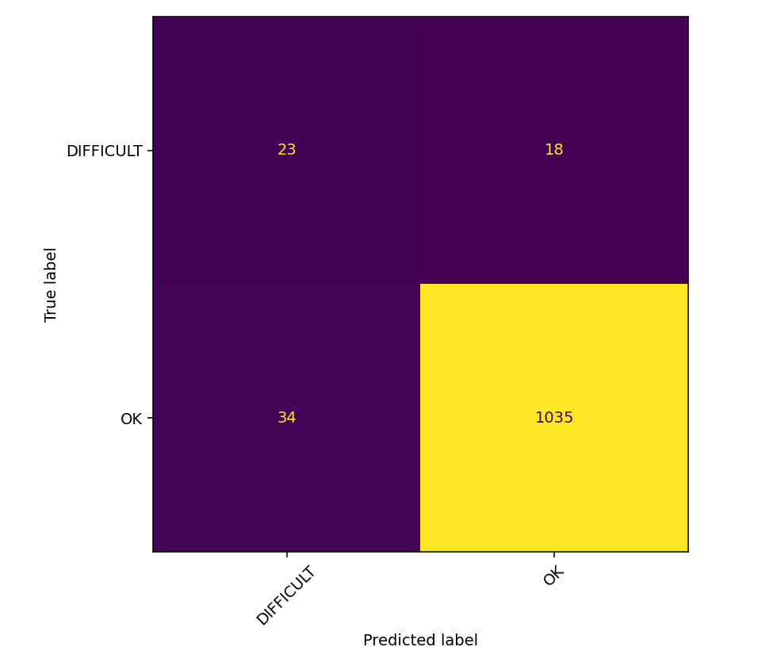
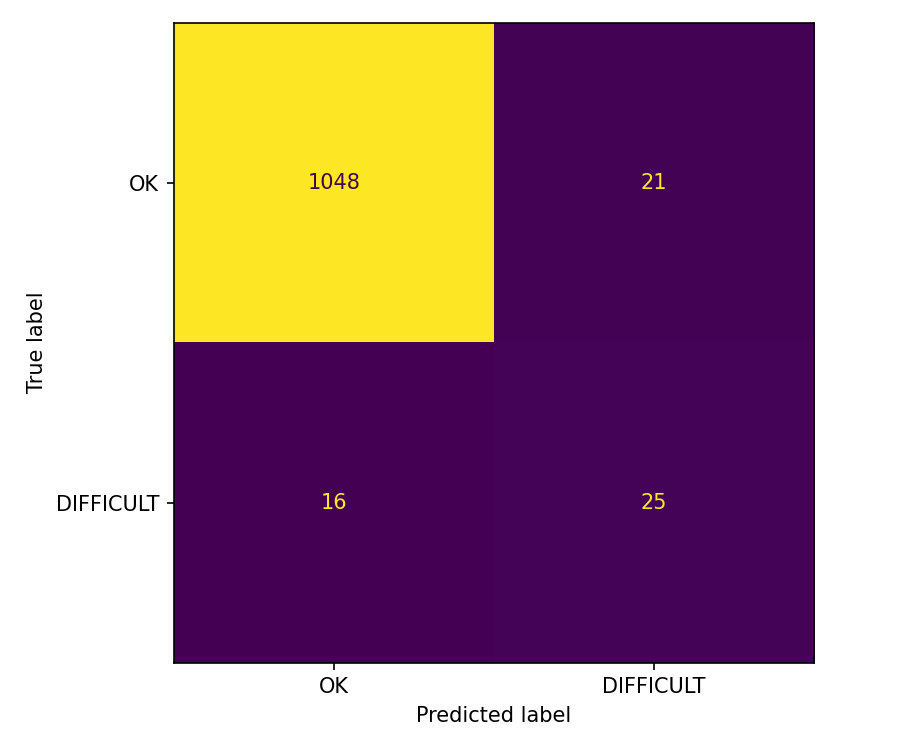
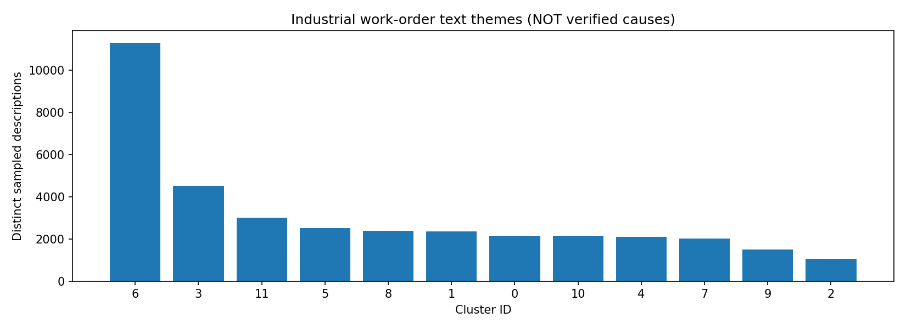
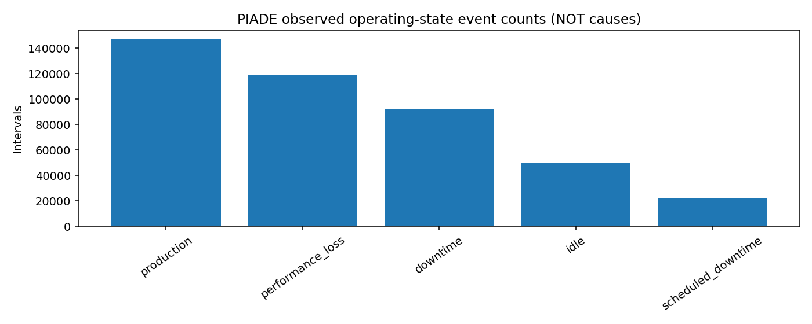

# DowntimeReason Miner — Maintenance Intelligence Research

**Hari 26 / 100 · FastAPI + React + NLP · Prototipe penelitian · Belum tervalidasi untuk keselamatan**
**Language / Bahasa:** [English](../../README.md) · [Bahasa Indonesia](README.md)

## Ringkasan

DowntimeReason Miner merupakan proyek hari ke-26 dalam rangkaian 100 Days of Projects: prototipe analisis teks dan intelijen operasional historis untuk penelitian. Proyek menggabungkan pengklasifikasi logbook perawatan penerbangan, pengelompokan tanpa supervisi atas work order industri sintetis, dan pelaporan historis status produksi PIADE. Ketiganya merupakan **tiga aliran bukti terpisah**, bukan satu prediktor gabungan atau kausal.

## Sebelum — Sekarang — Berikutnya

**Sebelum:** arsip mentah, tanggal work order tidak konsisten, anotasi penyebab sangat jarang, dan belum ada inferensi melalui peramban. **Sekarang:** notebook Kaggle yang dapat direproduksi, model Experiment 01 dan 02, dua belas klaster teks eksploratif, layanan FastAPI lokal, aplikasi React, serta laporan penelitian berversi. **Berikutnya:** memverifikasi Operational Analytics ujung ke ujung, menambah validasi eksternal berlabel, mengaudit pergeseran model dan makna klaster, menerapkan CI/penguatan keamanan, dan menyiapkan deployment penelitian dengan ruang lingkup terbatas.

## Pertanyaan penelitian

Aplikasi menanyakan (1) apakah entri logbook menyerupai anotasi `PROBLEM_TYPE` yang teramati, (2) **tema redaksi** mana yang paling cocok untuk deskripsi work order industri, dan (3) bagaimana sebaran historis downtime produksi, status idle, serta frekuensi alarm. Aplikasi **tidak** menjawab komponen mana yang rusak, mengapa rusak, apakah pesawat aman, atau kapan lini produksi akan gagal.

## Asal-usul dan pemisahan data

Sumbernya ialah **Industrial Maintenance Synthetic** (`Jvachier/industrial-maintenance-synthetic`, teks work order sintetis), **Annotated Maintenance Logbook** (rekaman Zenodo `20779601`, anotasi penerbangan), serta **PIADE** (rekaman repositori University of Padua `1459`, peristiwa produksi dan fitur per jam). Dataset mentah tidak didistribusikan ulang melalui repositori ini; periksa lisensi serta izin penggunaan lanjutan masing-masing sumber secara terpisah. Jangan pernah menggabungkan sumber berdasarkan nomor baris atau menyiratkan bahwa satu sumber menyediakan label untuk sumber lain.

## Audit data

Audit Kaggle membaca **1.048.779 baris maintenance sintetis**, menghasilkan **37.061 deskripsi work order unik yang dapat digunakan**; tujuh kolom tanggal memiliki puluhan ribu nilai tidak kosong yang tidak valid. Logbook berisi **6.169 catatan**, **3.531 nilai `PROBLEM` asli yang unik**, serta **76 sel `CAUSE` tidak kosong** (1,23%). Jumlah `PROBLEM_TYPE`: **6.011 `OK`**, **157 `DIFFICULT`**, serta **satu label lain yang hanya muncul sekali**. PIADE memiliki **429.394 interval mentah** dan **23.376 catatan per jam** dengan **164 kolom**. Kekosongan struktural dipertahankan alih-alih seluruhnya diganti nol.

## Metode dan pengendalian kebocoran data

Teks industri menggunakan TF-IDF kata (unigram/bigram) dilanjutkan MiniBatchKMeans dengan **12 klaster**; ID klaster bukan kode penyebab yang tervalidasi. Eksperimen logbook hanya mempelajari teks `PROBLEM` yang dinormalisasi, bukan `ACTION` atau deskripsi perbaikan setelah kejadian. Teks masalah identik setelah normalisasi tetap berada dalam satu grup; partisi train, validation, dan test tidak berbagi grup. Pemilihan model/threshold menggunakan validation; kemudian evaluasi held-out yang telah dikunci dilaporkan. Experiment 02 memakai kembali partisi Experiment 01, sehingga perbandingan ini bersifat iteratif, **bukan replikasi independen**.

## Model dan hasil aktual

**Experiment 01:** TF-IDF kata + Logistic Regression berbobot kelas, macro-F1 validation **0,672996**, macro-F1 held-out **0,722441**, accuracy **0,953153**, balanced accuracy **0,764585**, pengujian pada **1.110 baris**. **Experiment 02:** TF-IDF karakter + Logistic Regression berbobot kelas, macro-F1 validation **0,719584**, threshold terpilih **0,6505639906**, macro-F1 held-out **0,778683**, accuracy **0,966667**, balanced accuracy **0,795056**, precision minoritas **0,543478**, recall minoritas **0,609756**, F1 minoritas **0,574713**, average precision **0,585881**, ROC-AUC **0,959821**, pengujian pada **1.110 baris** dengan **41 kasus `DIFFICULT`**. Keduanya mengukur **prediksi anotasi logbook**, bukan penyebab downtime.

| Metrik | Experiment 01 | Experiment 02 |
|---|---:|---:|
| Macro-F1 | 0.722441 | 0.778683 |
| Accuracy | 0.953153 | 0.966667 |
| Balanced accuracy | 0.764585 | 0.795056 |

### Berkas bukti

- [`reports/logbook_final_metrics.json`](https://github.com/MENSTRUE/DowntimeReason-Miner/blob/main/reports/logbook_final_metrics.json)
- [`reports/experiment_02/heldout_metrics.json`](https://github.com/MENSTRUE/DowntimeReason-Miner/blob/main/reports/experiment_02/heldout_metrics.json)
- [`reports/research_gate.json`](https://github.com/MENSTRUE/DowntimeReason-Miner/blob/main/reports/research_gate.json)

## Temuan operasional

Jumlah peristiwa PIADE dari laporan tersimpan: **146.795 production**, **118.584 performance loss**, **92.084 downtime**, **50.149 idle**, dan **21.782 scheduled downtime** interval. Jumlah interval bukan jumlah kegagalan fisik yang berdiri sendiri. `piade_downtime_by_equipment.csv` mengagregasi `%downtime` yang teramati pada jam yang sama; data tersebut bukan prakiraan maupun supervisi akar penyebab.

## Arsitektur sistem

Klien peramban React/TypeScript/Vite memanggil backend FastAPI `/api/v1`. Backend memuat tiga artefak joblib tepercaya dari `models/` dan membaca laporan CSV/JSON hasil ekspor yang tidak diubah dari `reports/`; jalur data model dan laporan berbeda. REST API menyediakan health, klasifikasi tunggal/batch, penetapan tema tunggal/batch, serta analitik historis yang dibatasi daftar izin. CORS secara baku mengizinkan origin Vite lokal. Belum ada database, login, telemetri langsung, ETL terjadwal, infrastruktur cloud, ataupun aktuator fisik.

### Struktur repositori

```text
DowntimeReason-Miner/
├── README.md, AGENTS.md, LICENSE, .gitignore
├── notebooks/downtimereason-miner.ipynb
├── models/{industrial_text_themes.joblib,logbook_problem_category_champion.joblib,logbook_problem_type_experiment02_champion.joblib}
├── reports/{experiment_02/,*.json,*.csv}
├── features/industrial_nlp_sample.csv
├── assets/{plots/,screenshots/}
├── backend/{app/{api/routes/,core/,inference/,schemas/,services/},tests/,requirements.txt}
├── frontend/{src/{pages/,components/,hooks/,services/,styles/,types/},package.json,package-lock.json}
├── docs/{README.md,en/,id/}
└── scripts/
```

## Mulai cepat — Windows PowerShell

Clone repositori, buat lingkungan Python di `backend`, instal `requirements.txt`, lalu jalankan Uvicorn. Pada terminal kedua, jalankan `npm ci` dan `npm run dev` di `frontend`. Buka `http://127.0.0.1:5173`, dokumentasi API di `http://127.0.0.1:8000/docs`, dan health di `http://127.0.0.1:8000/api/v1/health`. Status `API connected` mengonfirmasi endpoint health, **bukan** berarti seluruh artefak model sudah dimuat. Periksa field JSON health `models` dan `ready_for_inference`.

```powershell
 git clone https://github.com/MENSTRUE/DowntimeReason-Miner.git
 cd DowntimeReason-Miner\backend
 py -3.11 -m venv .venv
 .\.venv\Scripts\Activate.ps1
 python -m pip install -r requirements.txt
 Copy-Item .env.example .env
 python -m pytest -q
 python -m uvicorn app.main:app --reload --host 127.0.0.1 --port 8000
```

Second terminal:

```powershell
cd DowntimeReason-Miner\frontend
Copy-Item .env.example .env
npm ci
npm run build
npm run dev
```

Set `frontend/.env` to `VITE_API_BASE_URL=http://127.0.0.1:8000`. The API client adds `/api/v1`; do not configure the prefix twice.

## Kontrak API dan semantik inferensi

`POST /api/v1/classify` menerima `{"text":"...","experiment":"02"}`. Experiment 02 menampilkan `positive_label=DIFFICULT`, `positive_score` (perkiraan probabilitas pengklasifikasi yang belum dikalibrasi), dan `decision_threshold≈0,650564`. Experiment 01 sengaja tidak menampilkan skor positif dan threshold yang bisa dibandingkan langsung. `OK` **tidak** berarti mesin aman; `DIFFICULT` **bukan** tingkatan keparahan. `POST /api/v1/themes` mengembalikan ID klaster eksploratif, bukan penyebab. `GET /api/v1/analytics/{report_name}` membaca laporan tersimpan, bukan sensor langsung.

## Pengujian dan verifikasi

Pengujian backend lokal yang dilaporkan pengguna menghasilkan **4 passed** melalui `python -m pytest -q`. Pengujian tersebut memeriksa perilaku rute/API dengan prediksi tiruan, bukan akurasi ilmiah model. Screenshot peramban membuktikan klasifikasi kedua eksperimen, perbandingan berdampingan, dan penetapan Theme Explorer (**Theme 04** untuk deskripsi pompa sentrifugal yang diberikan). Operational Analytics **belum dikonfirmasi melalui screenshot**. Jangan menyebut aplikasi sudah tervalidasi eksternal atau diuji untuk produksi. Jalankan `npm run build` secara terpisah untuk keluaran TypeScript dan Vite frontend.

## Reproduksibilitas dan integritas

Master notebook memakai random seed **42**, menyimpan identitas pembagian berdasarkan grup teks ternormalisasi, melaporkan pemeriksaan sensitivitas group-CV tiga fold hanya dari data training, memvalidasi CRC ZIP, dan membuat manifest SHA-256. Jalankan ulang terhadap lokasi input Kaggle asli `/kaggle/input/datasets/wafabila/downtimereason-dataset`. Reproduksi memerlukan dataset asal dan versi paket yang kompatibel; health API berwarna hijau bukan reproduksi training. Gunakan file asli di `reports/experiment_02/` sebagai bukti numerik utama dan jangan membuat klaim performa baru yang di-hardcode.

## Keterbatasan dan model ancaman

`CAUSE` kosong pada 98,77% logbook; belum ada target penyebab fisik lintas-domain yang tervalidasi. Ketimpangan `OK`/`DIFFICULT` yang berat serta sedikitnya dukungan pengujian kelas minoritas membatasi kepastian. Penggunaan ulang partisi test selama iterasi dapat memunculkan bias seleksi. Bahasa, pergeseran domain, tanggal tidak valid, duplikasi deskripsi, dan input pengguna yang tidak dibatasi merupakan risiko. Pemuatan Joblib/pickle mengeksekusi kode Python: **hanya muat artefak tepercaya**. Belum ada autentikasi, pembatasan laju, kontrol akses teraudit, kalibrasi model, studi lapangan langsung, atau sertifikasi keselamatan. Jangan gunakan prediksi untuk menunda perawatan atau mengesampingkan prosedur ahli.

## Batas deployment

Mode yang didukung adalah **demonstrasi penelitian lokal**, bukan produksi internet terbuka. Sebelum deployment publik, tetapkan/periksa versi dependensi, pindai rahasia, atur origin CORS yang tepat, isolasi pemuatan artefak, batasi akses file dan jaringan, tambah autentikasi, pembatasan laju, kontrol ukuran permintaan, logging terstruktur tanpa teks mentah sensitif, TLS, observabilitas, dan respons insiden. Jangan membuka port 8000 ke publik secara baku. Bedakan build statis React dari API inferensi yang diamankan; variabel lingkungan Vite tertanam saat proses build.

## Peta jalan dan kriteria penerimaan

**P0:** verifikasi layar Operational Analytics terhadap CSV/JSON tersimpan; lakukan smoke test seluruh endpoint dan kegagalan saat artefak tidak ada. **P1:** terapkan evaluasi luar-domain berlabel dan dokumentasikan kesalahan subgrup/ketimpangan; validasi interpretasi setiap klaster bersama pakar. **P2:** CI (`pytest`, build TypeScript, lint), lock paket/lingkungan Python yang dapat direproduksi, pemeriksaan hash kode dan artefak, serta observabilitas terkontrol. **P3:** deployment penelitian dengan autentikasi, tinjauan keselamatan, dan dataset akar penyebab fisik yang dirancang terpisah apabila menjadi tujuan. Setiap tonggak harus memiliki bukti yang dapat ditelusuri, bukan sekadar lencana selesai.

## Lisensi dan atribusi

File `LICENSE` repositori menggunakan **MIT**, hak cipta © 2026 Wafa Bila Syaefurokhman. Izin MIT mencakup kode/dokumentasi yang berasal dari repositori sesuai ketentuannya, **tidak otomatis mencakup dataset eksternal, model pihak ketiga, gambar, atau karya milik kontributor lain**. Pertahankan pemberitahuan lisensi; verifikasi ketentuan setiap dataset sumber secara terpisah. Referensi ilmiah, lisensi, dan asal-usul data harus dicatat dalam dokumentasi, bukan diasumsikan mengikuti lisensi repositori.

## Plot dan bukti visual

### Matriks kebingungan held-out Experiment 01


### Matriks kebingungan held-out Experiment 02


### Frekuensi klaster industri


### Frekuensi status operasional PIADE


## Screenshot aplikasi


## Pemecahan masalah

### `/api/v1/api/v1/health` menghasilkan 404
Atur `VITE_API_BASE_URL=http://127.0.0.1:8000`; frontend sudah menambahkan prefiks.

### API terhubung tetapi prediksi gagal 503
Periksa tiga artefak tepercaya dalam `models/`; mulai ulang Uvicorn dan periksa `/api/v1/health`.

### Build frontend gagal pada tipe TypeScript
Jaga konsistensi pembungkus respons klien (`.result`) dengan halaman React lalu jalankan `npm run build`.

### Laporan analitik tidak tersedia
Salin CSV/JSON Kaggle ke `reports/`; simpan JSON Experiment 02 dalam `reports/experiment_02/`.

### Model/versi salah atau peringatan unpickling
Hanya muat file tepercaya; selaraskan lingkungan scikit-learn dengan pengekspor sebelum menafsirkan prediksi.

## Pertanyaan umum

### Apakah `OK` berarti mesin aman?
Tidak. Itu anotasi logbook penerbangan, bukan putusan keselamatan peralatan.

### Mengapa ada tiga dataset?
Masing-masing mendukung pertanyaan berbeda: tema teks, label anotasi, dan status operasional historis. Tidak ada keterkaitan antarbaris yang tervalidasi.

### Mengapa Experiment 02 lebih baik di notebook tetapi terkadang berbeda di aplikasi?
Metrik agregat held-out tidak menjamin setiap input sembarang; pergeseran domain serta ketimpangan kelas tetap ada.

### Bisakah ini memprediksi downtime mendatang atau mendiagnosis akar penyebab?
Tidak. Belum ada target kejadian masa depan maupun label penyebab fisik yang tervalidasi.

### Bolehkah berkas model di-commit ke Git?
Ya, ketiga artefak kecil dan tepercaya tersebut sudah berada di repositori; hindari biner besar/tidak aman dan periksa asalnya.

## Tautan referensi

- [Industrial Maintenance Synthetic](https://huggingface.co/datasets/Jvachier/industrial-maintenance-synthetic)
- [Annotated Logbook — Zenodo](https://zenodo.org/records/20779601)
- [PIADE — ResearchData UniPD](https://researchdata.cab.unipd.it/1459/)
- [Source repository](https://github.com/MENSTRUE/DowntimeReason-Miner)

